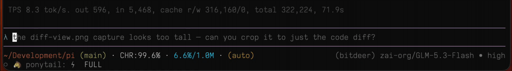
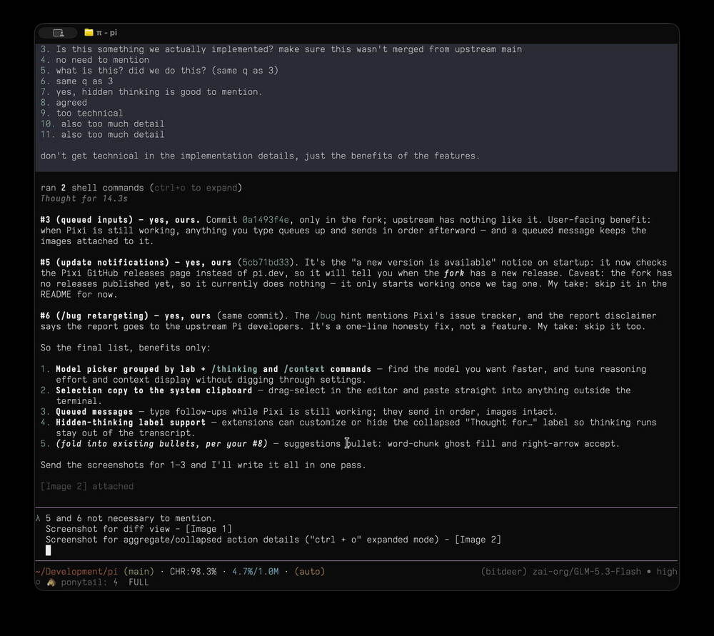
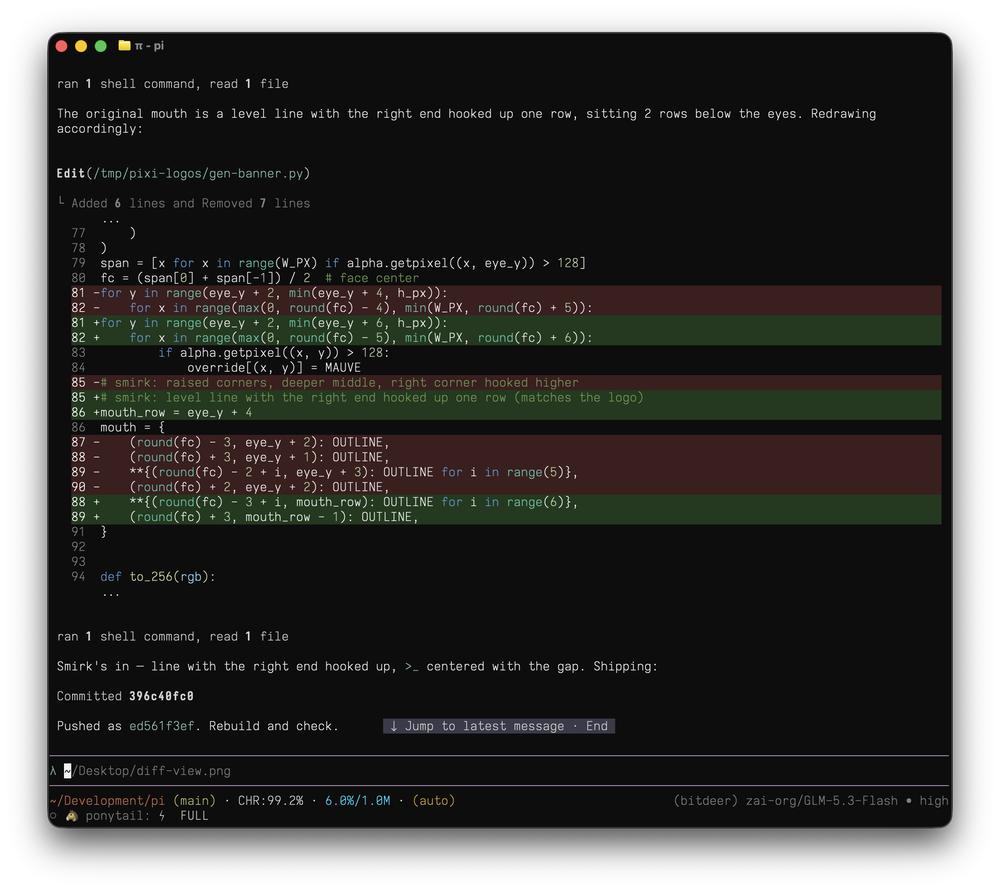
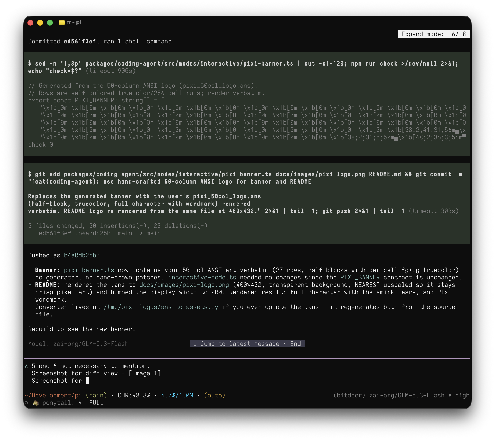
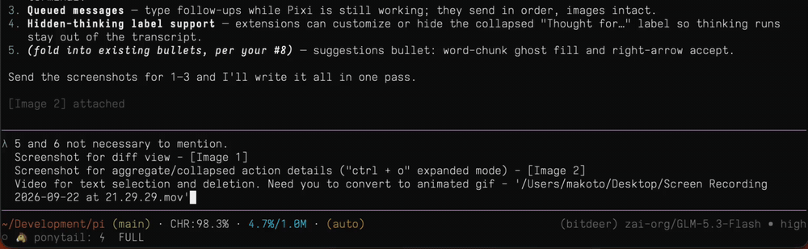

<p align="center">
  <a href="https://github.com/Panoplos/Pixi">
    
  </a>
</p>
<p align="center">
  <a href="https://github.com/earendil-works/pi"></a>
  <a href="https://github.com/earendil-works/pi/commit/6e2222a8dda06e3d69fad46d630f152f5873567a"></a>
</p>

> New issues and PRs from new contributors are auto-closed by default. Maintainers review auto-closed issues daily. See [CONTRIBUTING.md](CONTRIBUTING.md).

# Pixi

**P**i e**X**perience **I**mproved.

Pixi is [Pi](https://github.com/earendil-works/pi) with extra UX and provider work merged in. Nothing is taken away: providers, config, extensions, skills, prompt templates, themes, packages, RPC, and the SDK behave exactly as Pi documents them.

This README covers what Pixi adds and how to install it. Pi itself is documented elsewhere, and those docs apply here as-is:

- [Pi README](https://github.com/earendil-works/pi#readme) — project overview, Nix builds, monorepo packages, release binaries, supply-chain rules
- [pi.dev/docs](https://pi.dev/docs/latest) — setup and usage
- [`packages/coding-agent/docs`](packages/coding-agent/docs) — sessions, [CLI](packages/coding-agent/docs/cli.md), [RPC](packages/coding-agent/docs/rpc.md), [SDK](packages/coding-agent/docs/sdk.md), [extensions](packages/coding-agent/docs/extensions.md), [skills](packages/coding-agent/docs/skills.md), [prompt templates](packages/coding-agent/docs/prompt-templates.md), [themes](packages/coding-agent/docs/themes.md), [containerization](packages/coding-agent/docs/containerization.md)

## Installing Pixi

```bash
curl -fsSL https://raw.githubusercontent.com/Panoplos/Pixi/main/scripts/install.sh | sh
```

The installer downloads the latest release binary for your platform from the [releases page](https://github.com/Panoplos/Pixi/releases) and installs it as `pixi`.

Until the first release is published, run Pixi from source:

```bash
git clone https://github.com/Panoplos/Pixi && cd Pixi
npm install --ignore-scripts
npm run build
mkdir -p ~/.local/bin && ln -s "$PWD/packages/coding-agent/dist/bundle/cli.js" ~/.local/bin/pixi
```

Pixi needs Node.js 22.19 or newer. Start it in the directory you want to work in, connect a provider with `/login`, and give it a task:

```bash
cd /path/to/project
pixi
```

## Enhancements in this fork

- **Extra providers** — Bitdeer, DeepInfra, and Inco are wired in as first-class providers, with model catalogs seeded from live API data and refreshed by the model generator.
- **Next-message suggestions** — after each assistant reply, a small model drafts the suggested next prompt, shown as ghost text that fills in word by word; Tab accepts the whole line, or the right arrow accepts it a word at a time. The suggestion model is picked separately from your main model — choose it in `/settings` → Suggestion model, or set `suggestions.model` (a `"provider/model"` string) in `~/.pi/agent/settings.json` — so a fast, cheap model can draft suggestions while your main model does the heavy lifting.


- **Model picker grouped by lab** — `/model` groups models by the company that makes them, and `/thinking` and `/context` let you tune reasoning effort and context display without digging through settings.
- **Editor UX** — click to position the cursor, drag to select with delete/replace, and pasted images become atomic `[Image N]` markers that move and delete as one unit. Selections copy straight to the system clipboard.



- **Queued messages** — type follow-ups while Pixi is still working; they send in order, images intact.
- **Write/edit previews** — tool previews render proper diffs for file writes and edits, so you can review changes before they land.


- **Collapsible activity** — batches of tool calls collapse into one-line summaries ("ran 1 shell command, read 1 file") that expand in place with ctrl+o, and a thinking spinner shows what Pixi is doing between actions.





- **Configurable prompt prefix** — the input editor prefix is a `promptPrefix` setting with a matching optional theme color (falls back to `accent`).


- **RPC on a running session** — an interactive session serves the RPC protocol on `~/.pi/agent/rpc/<session id>.sock`, so a script or editor can prompt or inspect a session you are using in the terminal; the footer shows `rpc <session id>` while it is on, and `--no-rpc` turns it off. See [RPC mode](packages/coding-agent/docs/rpc.md#drive-a-running-interactive-session) and [CLI Integration](packages/coding-agent/docs/cli-integration.md#control-pi-with-rpc) for `RpcClient` and `connectRpcClient()`.


- **Secret masking** — [`key-guard.ts`](packages/coding-agent/examples/extensions/key-guard.ts) masks API keys, tokens, and PEM blocks before they enter model context. It shells out to [`pixi-mask`](https://github.com/Panoplos/pixi-mask), a 1.5 MB Rust CLI that runs the betterleaks rule set over a tool result in a few milliseconds, and falls back to in-process patterns when the binary is not on `PATH`.


## Sandboxing

Like Pi, Pixi has no built-in permission system: it runs with the permissions of the user and process that launched it. For stronger boundaries, containerize it — see [containerization](packages/coding-agent/docs/containerization.md) for a host-plus-micro-VM extension, plain Docker, and policy-controlled sandboxes.

## Working on Pixi

```bash
npm install --ignore-scripts  # Install all dependencies without running lifecycle scripts
npm run build         # Refresh model data, then build all packages
npm run build:offline # Rebuild using existing model data without network access
npm run check         # Lint, format, and type check
./test.sh            # Run tests (skips LLM-dependent tests without API keys)
./pi-test.sh         # Run pixi from sources (can be run from any directory)
```

Pixi follows Pi's monorepo layout and build scripts. For Nix builds, local package artifacts, standalone binaries, and the supply-chain rules (pinned dependencies, the lockfile gate), use the matching sections of [Pi's README](https://github.com/earendil-works/pi#readme).

## Contributing

See [CONTRIBUTING.md](CONTRIBUTING.md) for contribution guidelines and [AGENTS.md](AGENTS.md) for project-specific rules (for both humans and agents). Longer term plans for Pi live in the [RFCs](https://rfc.earendil.com/keyword/pi).

## License

MIT
